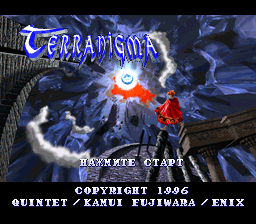
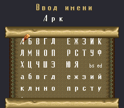
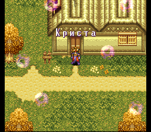
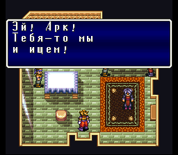
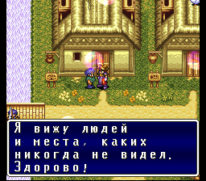
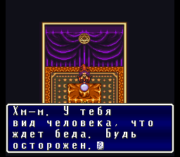

# Terranigma — русский перевод

<!-- ===== Основной текст (пишет DigitalM00N) ===== -->

Русский перевод для игры Terranigma (SNES)

Разбор рома и перевод сделан через Cladue Opus 5.5

<!-- ===== конец основного текста ===== -->

## Скриншоты

| | |
|:-:|:-:|
|  |  |
|  |  |
|  |  |

## Установка патча

1. Нужна копия европейской версии: `Terranigma (Europe).sfc`, 4 МБ, MD5 `d202156549f981f6dafc759575dd6e67`.
2. Наложите [`patch/Terranigma_RUS.bps`](patch/Terranigma_RUS.bps) любой программой для BPS (Floating IPS, Beat, Rom Patcher JS).
3. Получится ROM на 8 МБ (ExHiROM). Подходят Mesen 2, bsnes/higan, свежий Snes9x.

## Инструменты

Нужен только Python 3, сторонние модули не используются.

| Файл | Назначение |
|---|---|
| `tools/extract.py` | извлекает текст из ROM в `script/eng/` |
| `tools/insert.py` | собирает ROM и патч из `script/rus/` |
| `tools/verify.py` | проверяет собранный ROM против оригинала |
| `tools/progress.py` | сколько записей переведено |
| `tools/preview.py` | рисует окно диалога в PNG |
| `tools/cyrfont.py` | кириллический шрифт |
| `tools/screens.py` | надписи-картинки: заставка, титульный экран, титры |
| `tools/lz.py` | сжатие графики игры |

Текст перевода — в `script/rus/`, глоссарий — `script/glossary.txt`.

## Сборка

```
python tools/extract.py "Terranigma (Europe).sfc" script/eng
python tools/insert.py "Terranigma (Europe).sfc" script/rus build/Terranigma_RUS.sfc --bps build/Terranigma_RUS.bps
```

Или `build.bat`. Подробности о формате текста и устройстве патча — в [docs/TECHNICAL.md](docs/TECHNICAL.md).
